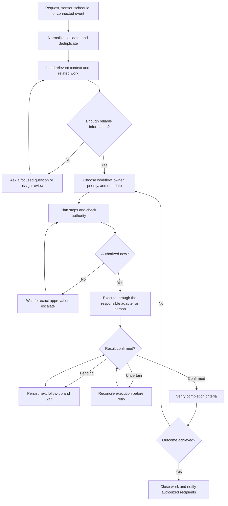

# Office and chief of staff operating model

The product should own the coordination work needed to keep the office and company running: notice a need, establish what matters, arrange the work, follow up, verify the result, and keep the right people informed. Scope includes office management, executive assistance, and chief of staff support. Each capability builds on the same durable workflow.

This is a proposed product and logic blueprint. The responsibility inventory is a starting map to validate against the actual role. It does not claim that every workflow is implemented or that software performs physical work or holds executive authority.

## Responsibility map

The first question for each responsibility is what outcome the person owns. A message sent, purchase proposed, or task created is an intermediate step.

| Responsibility | Typical trigger or cadence | Work to coordinate | Evidence of completion |
| --- | --- | --- | --- |
| Supplies and inventory | Low stock, consumption forecast, employee request | Count stock and open orders; select quantities; compare approved options; obtain approval; track delivery and exceptions | Receipt confirmed and stock updated |
| Food and kitchen | Daily readiness, lunch schedule, visitors or events | Collect headcount and relevant dietary requirements with restricted access; arrange food; maintain coffee and kitchen supplies | Delivery or setup confirmed; shortages addressed |
| Cleaning and waste | Schedule, full bin, reported condition | Apply cleaning checklist; assign staff or provider; arrange access; chase missed work | Responsible person confirms work and reports remaining issues |
| Repairs and maintenance | Broken equipment, inspection, recurring service | Triage impact; arrange temporary workaround; define repair scope; obtain quote and approval; schedule technician | Repair verified by an appropriate person; unresolved fault stays open |
| Office environment | Calibrated readings, complaints, recurring inspection | Detect persistent conditions; avoid repeated alerts; assign inspection or remediation; track recovery | Fresh measurements show recovery, with any maintenance work separately verified |
| Premises and landlord | Fault report, inspection, lease milestone, move | Coordinate access, building management, utilities, space changes and responsibilities | Agreed work accepted or a dated decision recorded |
| Assets and equipment | New starter, request, failure, return | Allocate equipment; record custody; arrange setup and repair; track returns and warranties | Equipment received and checked, with custody updated |
| Rooms and workspace | Meeting request, booking conflict, occupancy change | Find space; check capacity and equipment; reserve and prepare; resolve conflicts | Booking confirmed and room ready |
| Visitors, deliveries and post | Expected guest, courier notice, parcel arrival | Identify host and destination; prepare arrival instructions; notify host; route items | Host or recipient acknowledges handoff |
| Employee help desk | Voice, button, form, or connected inbox request | Clarify need; find policy or owner; resolve or route; keep requester updated | Requester or responsible owner confirms outcome |
| Onboarding | Approved start date or role change | Generate checklist; coordinate equipment, access, orientation and introductions; chase dependencies | Required checklist verified by accountable owners |
| Offboarding | Authorized departure or role change | Coordinate access removal through authorized owners; recover assets; hand over work and update records | Required confirmations and asset reconciliation recorded |
| Travel and expenses | Approved trip, itinerary change, reimbursement request | Gather constraints; compare options; prepare booking; track changes, receipts and reconciliation | Authorized booking confirmed and expenses reconciled |
| Team events and hospitality | Recurring event or approved request | Establish purpose, budget and headcount; compare venues or providers; coordinate logistics | Event delivered and costs reconciled |
| Vendors and subscriptions | New need, invoice, renewal, poor service | Compare providers; track agreements, renewal dates and service issues; prepare renewal or cancellation decision | Decision executed by an authorized owner and provider result recorded |
| Finance administration | Invoice received, expense submitted, monthly review | Match purchase, receipt and invoice; flag discrepancies; route to finance; track budget commitments | Finance acknowledges disposition; payment requires separate verified evidence |
| Founder calendar and inbox | Incoming request, scheduling conflict, daily review | Triage by agreed priorities; protect focus time; draft replies; arrange meetings and travel | Authorized reply or calendar change confirmed, with conflicts resolved |
| Meeting preparation and follow-through | Upcoming meeting, meeting end | Assemble agenda and relevant context; capture decisions and commitments; assign owners and dates | Decisions recorded; actions tracked through verified closure |
| Priorities and project execution | Weekly planning, milestone, dependency change | Turn agreed goals into owned work; check progress; find blockers; coordinate handoffs and escalation | Milestone accepted against its completion criteria |
| Decisions and research | Founder question or pending decision | Gather source-backed options; compare costs, constraints and uncertainty; prepare a recommendation | Authorized person records the decision and resulting actions have owners |
| Company reporting and stakeholder preparation | Daily digest, weekly review, board or investor deadline | Collect updates; reconcile conflicting status; prepare reports and briefing materials | Accountable owner approves the report; commitments become tracked work |
| Knowledge and process upkeep | Repeated question, policy change, incident review | Maintain procedures, ownership, contacts and decision history; propose recurring checks | Owner validates the update and affected workflows use the current version |
| People coordination | Hiring logistics, leave coverage, team concern | Schedule interviews; coordinate coverage; route sensitive issues to the appropriate leader | Accountable human confirms the handoff or decision |
| Incidents and continuity | Outage, urgent report, missing critical service | Alert accountable people through authorized channels; track mitigation, handoffs and recovery | Accountable human accepts recovery and assigns remaining follow-up |

Actual cleaning, repairs, deliveries, financial decisions, people decisions and strategic choices retain their human or provider owners. The system can coordinate them and track their results.

## Common workflow

Every domain uses the same logical sequence:

An authorized cancellation or explicit failure can end work with its reason recorded. A rejected proposal returns for revision or cancellation. Completion requires the workflow's evidence; accepting a request or creating a ticket does not prove the outcome.

## Logical records

These are proposed domain concepts, not new API payloads or database migrations.

| Record | Information needed |
| --- | --- |
| Event | Source, source event ID, observation time, receipt time, subject, validated payload and live or simulated provenance |
| Work item | Desired outcome, workflow type, source events, accountable owner, requester when known, priority, deadline, status and completion criteria |
| Step | Intended action, dependencies, responsible adapter or person, permitted inputs, status and expected result |
| Approval | Authorized approver, exact proposed action and scope, cost or other consequences, applicable policy version, expiry and decision |
| Execution attempt | Stable execution identifier, step, adapter, request snapshot, start time, provider reference and confirmed, failed or uncertain result |
| Follow-up | Work item or step, reason for waiting, next check time, expected response, reminder policy and escalation owner |
| Evidence | Source, time, result or owner confirmation, subject and reliability or freshness requirements |
| Context | Locations, assets, inventory, approved suppliers, agreements, relevant policies and authorized role directory |
| Commitment | Decision or promise, accountable owner, due date, related project or meeting and resulting work items |
| Recurring routine | Workflow template, cadence, timezone, next occurrence, missed-run policy and unique occurrence identity |

Knowledge must retain its source and age. Preferences are separate from permissions. Personal information is limited to what the workflow needs and restricted to the appropriate audience. Speaker identity remains informational and cannot establish authority.

## State and follow-up logic

At the common-work level, distinguish `new`, `needs_information`, `ready`, `awaiting_approval`, `active`, `waiting`, `blocked`, `completed`, `cancelled` and `failed`. A step's execution result additionally distinguishes `not_started`, `started`, `confirmed`, `failed` and `uncertain`.

Existing purchasing and maintenance states remain authoritative in the current runtime. A future common layer must map their states rather than rename them or replace their approval and execution checks. For example, an order can be confirmed while its overall replenishment work item is still waiting for delivery.

Every open work item needs an accountable owner and a next action, expected response or scheduled review. Waiting for a supplier, waiting for a person and being blocked by a dependency are distinct reasons with distinct follow-up rules. Missing ownership routes to a configured coordinator rather than silently disappearing.

Recurring work creates one occurrence per schedule slot, with timezone and missed-run behavior defined. A restart or repeated scheduler tick must not create the same occurrence twice. Unfinished work follows an explicit overlap policy: link and escalate the previous occurrence, or allow separate work when it represents a genuinely new obligation.

Reminders are bounded, coalesced where appropriate and subject to channel authorization and quiet-hour rules. A missed response eventually goes to an accountable human. Reminder delivery is tracked separately from task completion.

## Decision and authority logic

1. **Validate the signal.** Check source, freshness, schema and simulation status. Apply calibrated sensor thresholds deterministically. Treat incoming text, retrieved content and provider responses as untrusted evidence.
2. **Find existing work.** Retry the same source event safely; link fresh reports of the same unresolved need. Keep separate obligations separate, including different assets, periods and deliverables.
3. **Establish the need.** Load only relevant context. Ask for missing information that would change scope, price, authority or completion criteria. An LLM can interpret requests and propose plans; application code validates decisions.
4. **Prioritize.** Separate severity, business impact, deadline and confidence. Use explicit domain rules and agreed escalation times; urgency does not grant additional permission.
5. **Check authority.** Use authenticated identity, action scope, allowed recipients, spending caps and applicable policy. Default new adapters to observation or drafts. External messages, bookings, purchases, access changes and other commitments require explicit authorization covering the action.
6. **Bind approval to the action.** Record the exact product or service, quantity, total and terms for spending; recipients and content for messages; and equivalent concrete scope for other actions. A material change or expiry requires revalidation and, where required, new approval.
7. **Execute once and persist the result.** Record the attempt before side effects. Use provider idempotency where available. An uncertain purchase or booking requires reconciliation using the persisted execution identity before any retry.
8. **Verify the outcome.** Compare evidence with the completion criteria, then update inventory, commitments or related work. Sensor recovery does not establish that a repair or cleaning task was performed.
9. **Communicate appropriately.** Report concise operational progress and actionable exceptions to authorized recipients. Never expose private reasoning, credentials or unrelated sensitive context.

Human owners retain strategic tradeoffs, personnel decisions, sensitive disputes, legal commitments, banking authority and emergency judgment. Workflows can prepare evidence, route decisions and track authorized actions.

## Workflow templates

Each capability should declare the following before implementation:

- Triggers, recurrence and required context.
- How to recognize duplicate reports and related open work.
- Accountable owner, expected response time and escalation route.
- Required fields, policy checks and authority for each action.
- Ordered steps and dependencies, including work assigned to people.
- Waiting conditions, reminder limits and reconciliation behavior.
- Completion evidence, cancellation conditions and exception handling.
- Information permitted in each notification channel.

For replenishment, the outcome is usable stock at the correct location. The steps are confirm stock and inbound orders, calculate need, obtain an approved quote, authorize, order once, track arrival, confirm receipt and update inventory.

For onboarding, the outcome is a new starter ready for their first day. An authorized start event produces equipment, access, workspace and orientation work with named owners and dependencies. Access requests remain with an authorized identity-system owner. Completion requires each required checklist owner to confirm their result.

For meeting follow-through, the outcome is recorded decisions and fulfilled commitments. The workflow prepares an agenda, captures proposed actions, confirms owners and dates, requests authorized updates and escalates unresolved blockers. A meeting ending does not complete its resulting actions.

## Relationship to the current app

The current local app is the first slice: station or sensor input, interpreted requests, deterministic facility checks, purchasing proposals, approval, simulated execution, maintenance records and operational feedback. The Python API and SQLite remain the owners of durable state. Existing supplier simulation and exact approval requirements continue to apply. Live interpretation or supplier research does not establish real supplier execution.

This blueprint adds no runtime capability. Generic recurrence, work dependencies, follow-up scheduling, receipt verification, calendar and inbox operations, people workflows and company reporting need their own implementation and connected-service authorization. Specific APIs, schemas and ownership must be published in Hivemind before callers are changed.

## Build sequence

| Phase | Deliverable | Acceptance condition |
| --- | --- | --- |
| 1 | Common work and step model mapped to current tasks, orders, tickets and incidents | One accountable owner, explicit outcome and completion evidence; existing APIs and purchase safeguards remain compatible |
| 2 | Durable routines, waiting, dependencies, reminders and escalation | Scheduled work survives restart; repeated ticks do not duplicate work; unresolved work always has a next review; notification sends stay disabled until authorized |
| 3 | Complete replenishment and maintenance templates | Duplicate requests converge; stale approvals fail; uncertain execution reconciles; delivery or repair evidence is required for closure |
| 4 | People logistics, meeting follow-through, calendar and inbox templates | Reuse the common workflow; verify owner handoffs, permissions and completion with simulated adapters before enabling authorized integrations |
| 5 | Priorities, decision preparation, vendor renewals and reporting | Source-backed status and recommendations, explicit human decision owners and tracked resulting commitments |

Implement incrementally within the existing Python backend. Add adapters only when a workflow needs them. The first review should validate this map against a real week and month of the role, including interruptions, recurring obligations and work that usually falls through the cracks.
